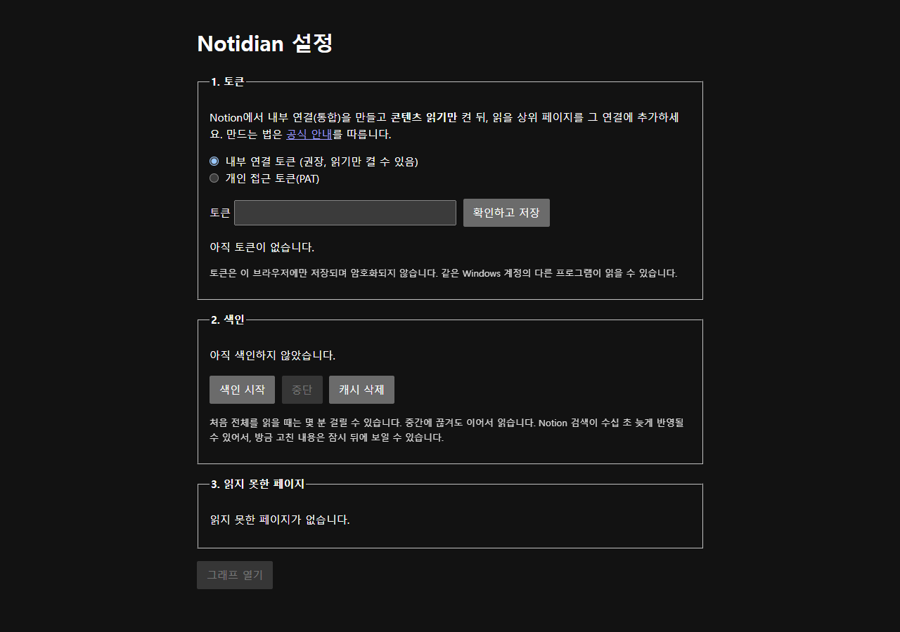
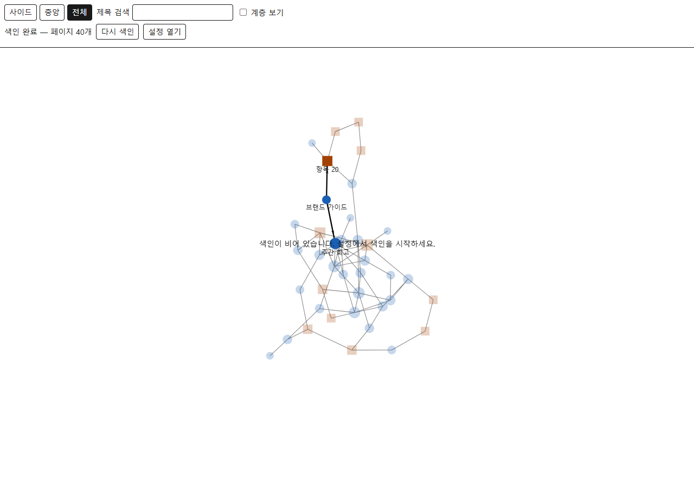

# 5. 전반 리뷰: 사용성·UI/UX·사용자 여정·기능·성능·호환성 (2026-11-13)

사용한 스킬: `design:design-critique`(디자인 비평), `design:accessibility-review`(WCAG 2.1 AA), `design:ux-copy`(문구), `dataviz`(그래프 색·범례 검증), `frontend-design`(디자인 방향). 요청하신 "UI UX Pro" 계열 스킬은 이 환경에 **없어서** 가장 가까운 위 스킬들로 대신했다. 이 문서는 **제안서**이며 코드는 고치지 않았다.

## 0. 한눈에 보기

**결론:** 데이터 쪽(색인 정확도, 변경 감지, 오류 복구, 개인정보)은 탄탄하다. 반면 **처음 쓰는 사람이 연결 지도를 읽고 쓰게 만드는 화면 층**이 얇다. 화면은 "동작하는 프로토타입" 수준이고, 가장 큰 위험은 첫 사용 흐름(토큰 만들기)과 그래프를 읽는 데 필요한 정보(범례·라벨·맞춤)가 없다는 것이다. 규모(2,000점 이상)에서는 성능이 한계에 닿는다.

| 영역 | 평가 | 근거 |
|---|---|---|
| 기능 정확성 | 상 | 실제 Notion 시험 데이터에서 정답표와 일치, 변경 감지, 리뷰 24건 처리 |
| 안정성·오류 복구 | 상 | 이어 읽기, 429 대기, 알람 이어 가기, 단위 시험 71개 |
| 개인정보 | 상 | 외부 서버 없음, 권한 2곳, 토큰 로그 금지(시험으로 검사) |
| 접근성 | 중 | 키보드 순서·포커스 링·대비 통과, **그러나 키보드로 Notion 페이지를 열 수 없음**, 320px 가로 스크롤, 그래프 대안 없음 |
| UI 완성도 | 하 | 기본 브라우저 스타일, 범례·확대 버튼·상세 패널 없음, **안내 문구가 그래프를 가리는 버그** |
| 첫 사용 경험 | 하 | 토큰 단계에서 이탈 위험, 색인 중 안내 부족, 첫 그래프가 작고 라벨 없음 |
| 성능(500점) | 상 | 60fps |
| 성능(2,000점) | 중 | 확대·축소 25fps, 배치 중 최대 0.68초 멈춤 |
| 성능(5,000점) | 하 | 배치 중 3fps, 확대·축소 13fps |
| 호환성 | 중 | Chrome 157에서 로드·동작 확인. Edge·Whale·macOS는 미확인 |

**가장 먼저 고칠 것 5가지(작은 수정, 위험 낮음)**
1. 안내 문구 겹침 버그: 점이 40개 그려져 있어도 "색인이 비어 있습니다"가 그래프 한가운데 보인다(밝은·어두운 테마 모두). `graph.html`에 `[hidden]{display:none}`이 빠진 한 줄 문제.
2. 키보드로 Notion 페이지 열기: 검색에서 점을 골라도 이동만 되고 페이지를 열 방법이 없다(WCAG 2.1.1 실패).
3. 설정 화면 320px 가로 스크롤(토큰 입력칸 폭 고정).
4. 토큰이 없는데도 "색인 시작"이 켜져 있다(눌러도 오류만 난다).
5. 용어와 안내 문구 정리("색인"/"캐시 삭제" 혼용, 빈 상태에 행동 버튼 없음).

## 1. 방법과 한계

| 항목 | 내용 |
|---|---|
| 환경 | **Chrome 157.0.8103.52**(헤드리스, 임시 프로필)에 `dist`를 CDP `Extensions.loadUnpacked`로 올림. 이전의 Ego Lite 점검 결과도 참고 |
| 화면 근거 | 확장의 실제 설정·그래프 화면을 캡처(가짜 40점 데이터, 밝은·어두운 테마, 1280·360px). 이미지는 `docs/images/review-20261113/` |
| 수치 근거 | 탭 순서·요소 크기·계산된 스타일·가로 넘침은 실제 화면에서 측정. 성능은 `qa/perf.html`(가짜 500·2,000·5,000점)을 같은 Chrome에서 측정 |
| 색 검증 | `dataviz` 스킬의 검증기(`validate_palette.js`), 실제 코드의 대비 계산 함수 |
| **한계** | 헤드리스는 소프트웨어 렌더링이라 실제 GPU 환경보다 **느리게** 나올 수 있다. 스크린리더(NVDA·VoiceOver)는 시험하지 못했다. 사용자 여정은 코드·화면·시험 데이터로 추정한 것이고 **사용자 인터뷰는 없다**. 실제 Notion 계정·토큰은 쓰지 않았다 |

참고(자동화): Chrome 157에서는 `--load-extension` 플래그가 더 이상 동작하지 않는다. 확장을 자동으로 올리려면 `--enable-unsafe-extension-debugging`과 CDP `Extensions.loadUnpacked`를 써야 한다(이번에 확인).

## 2. 사용자 여정 진단

가정한 사용자: 개인 Notion을 많이 쓰고, 옵시디언식 연결 그래프를 Notion 곁에서 쓰고 싶은 사람(비개발자 포함).

| 단계 | 지금 경험 | 마찰 | 제안 |
|---|---|---|---|
| ① 설치 후 첫 아이콘 클릭 | 설정 탭이 열리지만 **왜 열렸는지 설명이 없다** | 🟡 | 맨 위에 "먼저 설정을 마치면 그래프가 열려요(1/3)" 배너. 진행 단계 표시 |
| ② 토큰 준비(Notion 쪽 작업) | 한 문단과 영어 공식 문서 링크. 통합 만들기, 읽기만 켜기, 상위 페이지 연결 3가지를 사용자가 알아서 해야 함 | 🔴 **가장 큰 이탈 지점** | 번호 목록 3단계(체크 가능), 각 단계에 짧은 이유, 화면 예시. **저장 직후 "읽을 수 있는 페이지 N개 발견"을 바로 보여 주고, 0개면 "페이지를 연결에 추가하세요"를 안내**(검색 한 번이면 가능) |
| ③ 첫 색인(수 분) | 진행 문구뿐. 끝나도 알림이 없어 탭을 닫으면 모름 | 🟡 | 진행 막대와 예상 시간, "지금 그래프 열어 보기" 버튼, 완료 시 확장 아이콘 배지 또는 알림 |
| ④ 첫 그래프 | 작은 덩어리가 화면 가운데에 뜨고, 라벨이 없고, 범례가 없고, 안내 문구가 겹침(버그) | 🔴 | 자동 맞춤, 허브 점 라벨, 범례, 확대 버튼. 첫 방문에 "점을 올려 보세요" 힌트 1개 |
| ⑤ 일상 사용 | 아이콘→모드 선택, 점 클릭 이동. 현재 페이지는 **아이콘을 누른 순간에만** 반영됨. 키보드로 페이지를 열 수 없음 | 🟡 | 사이드 패널이 Notion 탭 이동을 따라가기, Enter로 열기 |
| ⑥ 유지 | 갱신이 수동, 마지막 색인 시각이 안 보임. 오류 시 "이어서 색인"은 있음 | 🟢 | 마지막 색인 시각 표시, 선택 가능한 자동 갱신 |

감정 곡선(추정): 설치 때 호기심 → **토큰 단계에서 최저점**(외부 화면, 영문 문서) → 색인 중 불안(끝났는지 모름) → 첫 그래프에서 기대와 어긋남(작고 이름 없음). 이 세 군데를 고치면 이탈이 가장 줄 것이다.

## 3. UI/UX 디자인 비평




**첫인상:** 설정 화면은 읽기 쉽고 단정하다. 그래프 화면은 기능은 하지만 "제품"처럼 보이지 않고, 상단의 흰 테두리 버튼들이 그래프보다 먼저 눈에 들어온다.

### 사용성
| 발견 | 심각도 | 제안 |
|---|---|---|
| 점 색·모양의 뜻을 알려 주는 **범례가 없다**(파란 원=페이지, 주황 네모=DB 항목, 회색=읽을 수 없음) | 🔴 | 범례를 상단 한 줄에 두고 필터 역할도 겸하게 한다(클릭하면 해당 종류 숨김) |
| 안내 문구("색인이 비어 있습니다")가 그래프 위에 **계속 겹침** | 🔴 | `[hidden]{display:none}` 추가(원인: `#empty`의 `display:flex`가 `hidden`을 덮어씀) |
| 첫 화면이 **작게** 뜬다(40점이 화면 가운데 약 300×450px). 외톨이 점은 화면 밖으로 밀리기도 함 | 🟡 | 데이터가 처음 들어오면 한 번 자동 맞춤(`zoomToFit`), "전체 보기" 버튼 |
| 라벨이 호버·확대 때만 보인다. 기본 화면에서는 무슨 점인지 알 수 없음 | 🟡 | 연결이 많은 점(허브) 몇 개는 기본 라벨, 확대할수록 라벨을 더 보이게 |
| 확대·축소·맞춤 버튼이 없다(마우스 휠·끌기만) | 🟡 | 오른쪽 아래 작은 버튼 3개 |
| 점을 눌러도 상세가 없다(바로 이동만). 실수로 누르면 페이지가 바뀜 | 🟡 | 첫 클릭=선택(오른쪽에 "이 페이지를 가리키는 N개/가리키는 M개, [Notion에서 열기]"), 이동은 버튼·더블클릭·Enter |
| "다시 색인"이 토큰 없이도 켜져 있고, 눌러도 오류만 난다 | 🟡 | 토큰이 없으면 비활성+이유, 또는 설정으로 안내 |
| 색인 중 그래프가 2초마다 갱신되며 점이 흔들린다 | 🟢 | 갱신 간격을 늘리고 위치를 고정한 채 점만 추가 |

### 시각 위계
- **먼저 눈에 들어오는 것:** 흰 테두리 툴바 버튼들. 그래프가 주인공이어야 하는데 툴바가 더 강하다.
- **읽는 흐름:** 툴바 2줄(모드→검색→계층 / 상태→버튼) → 그래프. 두 줄의 구분과 그룹 이름이 없다.
- **강조:** 현재 모드 버튼의 반전은 좋다. 반면 "현재 페이지" 테두리는 색이 있지만 크기가 작아 확대해야 눈에 띈다.

### 일관성
| 요소 | 문제 | 제안 |
|---|---|---|
| 버튼 높이 | 설정 40px, 그래프 30px | 한 가지로(36px 권장) |
| 용어 | "색인" / "캐시 삭제" / "페이지 읽기" 혼용 | 5절 용어 통일안 |
| 토글 표현 | 모드는 버튼, 계층은 체크박스 | 계층·필터는 같은 칩 형태로 |
| 상태 표시 | 진행은 글자만 | 상태 칩(색+아이콘+글자) |

### 좋은 점
- 호버하면 그 점과 이웃만 선명해지고 나머지는 흐려지며 방향 화살표가 보인다(이미지로 확인).
- 점이 **색과 모양**으로 이중 구분된다(색각 이상 대응). 계층 선은 점선으로 일반 연결과 구분된다.
- 시스템 밝은·어두운 테마를 따른다. 포커스 링이 두껍다(3px). 번호 붙은 3단계 설정은 순서가 있는 내용이라 적절하다.
- PAT를 고르면 위험 경고가 나온다. 읽기 전용 권장이 명확하다.

## 4. 접근성 감사 (WCAG 2.1 AA)

요약: 이슈 10건(심각 1, 주요 4, 경미 5).

| # | 이슈 | 기준 | 심각도 | 제안 |
|---|---|---|---|---|
| 1 | 검색에서 점을 골라도 **Notion 페이지를 열 수 없다**(이동만). 키보드 사용자는 그래프의 핵심 기능을 못 쓴다 | 2.1.1 | 🔴 | Enter=선택 후 다시 Enter=열기, 또는 "Notion에서 열기" 버튼 |
| 2 | 그래프의 **텍스트 대안이 없다**("연결 그래프" 한 줄 라벨뿐) | 1.1.1 | 🟡 | 목록/표 보기(이름·연결 수·이동). `dataviz` 스킬도 표 보기를 요구 |
| 3 | 설정 화면 320px에서 가로 스크롤(372 > 305) | 1.4.10 | 🟡 | 토큰 입력칸 `width:min(20em,100%)` |
| 4 | `<main role="img">`가 main 랜드마크를 지운다 | 1.3.1 | 🟡 | `<main>` 안에 `role="img"` 영역을 둔다 |
| 5 | 진행 문구가 0.5초마다 live 영역에서 갱신되어 스크린리더가 계속 읽을 수 있다(추정, 미시험) | 4.1.3 | 🟡 | 진행은 일정 간격·완료 때만 알린다 |
| 6 | "읽을 수 없는 페이지"가 파란 원과 **색만** 다르다(모양 같음) | 1.4.1 | 🟢 | 점선 테두리 또는 빈 원 |
| 7 | 토큰 오류가 입력칸과 연결되지 않는다 | 3.3.1 | 🟢 | `aria-invalid`, `aria-describedby` |
| 8 | 모션 감소 설정을 반영하지 않는다(확대 애니메이션·계속 다시 그리기) | 2.3.3(권장) | 🟢 | `prefers-reduced-motion`이면 애니메이션 0 |
| 9 | 그래프 도구줄 버튼 높이 30px, 체크박스 13px(라벨 클릭은 됨) | 2.5.5(권장 44) | 🟢 | 사이드 패널은 36~44px |
| 10 | 오류·빈 상태 문구가 "다음 행동"을 안내하지 않는다 | 3.3.3 | 🟢 | 5절 카피 |

### 색 대비(실제 코드 계산)
| 요소 | 밝은 테마 | 어두운 테마 | 기준 | 판정 |
|---|---|---|---|---|
| 본문 글자 | 17.40 : 1 | 15.11 : 1 | 4.5 | ✅ |
| 페이지 점 | 6.29 | 8.24 | 3 | ✅ |
| DB 항목 점 | 6.34 | 9.56 | 3 | ✅ |
| 읽을 수 없음(회색) | 5.33 | 7.24 | 3 | ✅ |
| 연결선 | **3.45** | 4.99 | 3 | ✅ 밝은 테마는 여유가 작고, 선이 가늘어 눈으로는 약해 보임 |
| 강조선 | 21.0 | 17.2 | 3 | ✅ |
| 현재 페이지 테두리 | 6.11 | 12.20 | 3 | ✅ |

### 키보드(실제 측정)
| 화면 | Tab 순서 | 판정 |
|---|---|---|
| 설정 | 공식 안내 링크 → 토큰 종류 → 토큰 입력 → 확인하고 저장 → 색인 시작 → 캐시 삭제 | ✅ 논리적. 비활성 버튼은 건너뜀 |
| 그래프 | 사이드·중앙·전체 → 제목 검색 → 계층 보기 → 다시 색인 → 설정 열기 | ✅ 논리적. **그래프 자체와 페이지 열기는 키보드로 닿지 않음** |
| 검색 | 방향키로 후보 이동, Enter로 선택, Esc로 닫기, 한글 조합 중 Enter 무시 | ✅ (선택 뒤 "열기"가 없음) |

## 5. UX 카피 개선

원칙: 같은 것은 같은 말로, 오류는 "무슨 일 + 이유 + 해결", 빈 상태는 "무엇 + 왜 비었나 + 시작 방법", 버튼은 동사.

**용어 통일안(제안)**

| 지금 | 제안 | 이유 |
|---|---|---|
| 색인 / 인덱스 / 캐시 | **연결 지도**(만들기), 저장된 데이터 | "색인"은 개발자 용어. 만드는 행동은 "읽기"로 풀어 쓴다 |
| 사이드 / 중앙 / 전체 | **옆 패널 / 가운데 창 / 전체 화면** | 위치가 말 그대로 드러남 |
| 계층 보기 | **폴더 구조 보기**(또는 하위 페이지 보기) | 사용자는 "계층"보다 Notion의 하위 페이지로 이해 |
| 읽은 / 발견한 페이지 | **n / m개 페이지 읽음** | 숫자 두 개를 한 문장으로 |

| 위치 | 지금 | 제안 | 톤 |
|---|---|---|---|
| 그래프 빈 상태 | 색인이 비어 있습니다. 설정에서 색인을 시작하세요. | **아직 그릴 연결이 없어요.** 설정에서 토큰을 넣고 "연결 지도 만들기"를 눌러 주세요. [설정 열기] | 안내 |
| 설정 안내 | Notion에서 내부 연결(통합)을 만들고 … 따릅니다. | **3단계로 준비해요.** ① Notion에서 내부 연결 만들기(읽기만 켜기) ② 읽을 상위 페이지를 그 연결에 추가 ③ 아래에 토큰 붙여 넣기 | 안내 |
| 토큰 저장 성공 | 토큰을 확인하고 저장했습니다. | 토큰을 저장했어요. **읽을 수 있는 페이지 38개를 찾았어요.** 이제 연결 지도를 만들어 볼까요? | 성공(다음 행동) |
| 접근 범위 0개 | (없음) | 읽을 수 있는 페이지가 없어요. Notion에서 페이지의 **⋯ → 연결**로 이 연결을 추가해 주세요. | 오류(해결) |
| 토큰 오류(401) | 토큰이 틀리거나 만료됐습니다. | 토큰이 맞지 않아요. 만료됐거나 잘못 복사됐을 수 있어요. Notion에서 토큰을 다시 복사해 주세요. | 오류 |
| 캐시 삭제 확인 | 저장된 색인을 지웁니다. 토큰은 지워지지 않습니다. 계속할까요? [확인][취소] | **저장된 연결 지도를 지울까요?** 토큰은 남고, 다시 만들려면 몇 분 걸려요. [지우기] [취소] | 확인(결과 설명) |
| 진행 | 색인 중 — 읽은 페이지 120개 / 발견한 페이지 340개 | 연결 지도를 만드는 중이에요 · 120 / 340개 페이지 읽음 | 중립 |
| 호출 제한 | 호출 제한이 계속되어 멈췄습니다. 잠시 뒤 이어서 색인하세요. | Notion이 요청을 잠시 막았어요. 1~2분 뒤 **이어서 만들기**를 눌러 주세요. | 오류 |

**말투 선택(사용자 결정):** 지금은 합쇼체("~합니다")로 일관된다. Notion 곁에서 가볍게 쓰는 도구라면 해요체("~해요")가 더 가깝다.

## 6. 그래프 시각화 검토 (`dataviz` 기준)

| 점검 | 결과 | 조치 |
|---|---|---|
| 형태 선택 | 연결 관계에는 노드-링크가 맞다 | - |
| 색 검증(밝은 테마, 페이지·DB 항목 2색) | ✅ 5개 검사 통과(CVD ΔE 24) | - |
| 색 검증(어두운 테마) | ❌ **밝기 범위 이탈**(#7ab7ff, #ffb066이 너무 밝은 파스텔) | 통과하는 값으로 교체: `#4f8ff0` / `#d5702a`(밝기·CVD·대비 모두 통과) |
| 회색(읽을 수 없음) | "채도 바닥" 실패로 보이나, 이것은 **범주 색이 아니라 상태 표시**라 의도된 회색이다 | 상태는 색 대신 **점선 링**을 겸해 표시 |
| **범례** | ❌ 범주가 2개 이상인데 범례가 없다 | 범례 필수(클릭해 필터) |
| **표 보기** | ❌ 없음 | 목록/표 보기 추가(접근성과 겸용) |
| 색은 "순위"가 아니라 "대상"을 따른다 | ✅ 종류별 고정 | - |
| 직접 라벨은 선택적으로 | ⚠ 기본은 없음, 호버 때만 | 허브 몇 개는 기본 라벨 |
| 얇은 선과 호버 | ✅ 호버 강조·이웃만 선명(이미지 확인) | 기본 선 두께 1.1px는 밝은 테마에서 약해 보임 → 1.3px 검토 |
| 마우스 전용 상호작용 | ❌ 키보드 대안은 검색뿐 | 3절·4절의 1번 |

## 7. 호환성

| 항목 | 상태 | 비고 |
|---|---|---|
| Chrome 157(Windows) | ✅ **확인** | 확장 로드, 서비스 워커 시작, `sidePanel.open/close`, `alarms`, `storage.session`, 틀린 토큰으로 Notion API 호출(CORS) → 401 응답 확인 |
| Chrome 116~156 | ⚠ 미확인(설계상 가능) | 사용 기능의 최소 버전: `sidePanel.open` 116, `storage.session` 102, `AbortSignal.timeout` 103, `sidePanel.close` 141(없으면 건너뜀). `alarms` 30초 간격은 120 이상. **선언한 최소 116은 120으로 올리는 것을 권장** |
| Edge·Brave·Naver Whale(Chromium) | ❓ 미확인 | 특히 `chrome.sidePanel` 지원이 다를 수 있다. 한국 사용자는 Whale 비중이 있음 |
| Firefox·Safari | ❌ 비대상 | MV3 서비스 워커+사이드 패널 의존. 대응하려면 별도 작업 |
| macOS·Linux | ❓ 미확인 | 코드에 OS 의존은 없으나 시험은 Windows만 |
| Notion 웹앱 `app.notion.com` | ✅ | 사용자 확인 |
| Notion 데스크톱 앱·모바일 | ❌ | 확장 불가 |
| `www.notion.so`·`notion.site` | ⚠ | 권한·콘텐츠 스크립트가 `app.notion.com`만 허용. 옛 주소로 여는 계정은 중앙 창이 안 뜰 수 있음 → 선택 권한(optional host)으로 확장 검토 |
| 디스플레이 배율 | ✅ 1.5배 시험 | 2배·4K는 미시험 |
| 고대비(forced-colors)·스크린리더 | ❓ 미시험 | 캔버스는 고대비 색을 무시함 |
| 로케일 | 한국어만 | 다국어 구조 없음 |

## 8. 성능

**측정(Chrome 157, 헤드리스 소프트웨어 렌더링, 1280×900, 가짜 데이터)**

| 점수·연결 | 배치 중(열림~3초) 평균 | 배치 중 가장 긴 프레임 | 안정 뒤 확대·축소 | 안정 뒤 가장 긴 프레임 | 판정 |
|---|---|---|---|---|---|
| 500 · 1,250 | 58 fps | 150 ms | **60 fps** | 33 ms | ✅ 쾌적 |
| 2,000 · 5,000 | 15 fps | **684 ms** | 25 fps | 167 ms | ⚠ 쓸 수는 있으나 끊김 |
| 5,000 · 12,500 | 3 fps | **2,000 ms** | 13 fps | 283 ms | ❌ 사실상 사용 불가 |

참고: 배치 계산만 Node에서 재면 500점 0.84초, 2,000점 3.75초(300틱). Notion 워크스페이스는 보통 수백~수천 페이지이고 파워 유저는 1만 이상도 있어서 **2,000점 이상 전략이 필요**하다.

**색인(읽기) 속도:** 페이지당 약 0.83초 → 500페이지 약 7분, 2,000페이지 약 28분, 5,000페이지 약 69분. 원인은 Notion 한도(평균 초당 3회)와 페이지당 요청 2번 이상.

| 개선안 | 기대 효과 | 크기 | 근거 |
|---|---|---|---|
| **검색 결과에 이미 들어 있는 속성(relation·제목 속 언급)을 재사용**해 페이지별 `GET page`를 없앰(언급으로 새로 발견한 페이지만 따로 읽기) | 페이지당 요청 약 2.3→1.3회, 색인 시간 **약 40% 단축**(500페이지 7분→약 4분, 추정) | M | 시험 S-3 계산 |
| 포인터 판정을 우리 코드로 하고 `force-graph`의 그림자 캔버스(`enablePointerInteraction(false)`)를 끔 | 프레임당 비용 감소(라이브러리 문서가 "더 빠르다"고 언급, **효과는 실측 필요**) | M | `force-graph` 문서 |
| 배치 비용 상한: `cooldownTicks`, 큰 그래프는 `warmupTicks` 분할, 갱신 중에는 재배치를 줄여 흔들림 제거 | 열림 시 멈춤(684ms)과 색인 중 흔들림 완화 | M | 측정 |
| 규모에 따라 단순 렌더(1,500점 초과면 화살표·라벨 생략, 선 일괄 그리기) | 2,000점 확대·축소 25→30fps 이상 목표 | M | 측정 |
| 5,000점 이상: WebGL 렌더러·워커 배치 검토 | 근본 해결 | L | 새 라이브러리 승인 필요 |
| 요청 간격 350ms를 토큰 버킷(짧은 연속 허용)으로 | 호출 제한 위험이 있어 측정 후 판단 | S~M | Notion 한도 |

**제안 목표(PRD NF 추가):** 2,000점에서 확대·축소 ≥30fps, 배치 중 프레임 정지 ≤200ms, 500페이지 색인 ≤5분.

**QA 도구 결함:** `qa/perf.html`의 "첫 그림까지 시간"이 음수(−7ms)로 나온다. 시작 시각 기준이 어긋난 측정 오류이므로 "배치가 안정될 때까지 시간"을 따로 재도록 고친다.

## 9. 기능성: 옵시디언 대비 갭과 제안

이 프로젝트의 출발점이 "노션에 없는 옵시디언 기능"이다. 그래프 하나만으로는 그 가치의 일부일 뿐이고, **백링크 패널·로컬 그래프**가 더 자주 쓰이는 기능이다.

| 기능 | 옵시디언 | Notidian 지금 | 제안 |
|---|---|---|---|
| 전체 그래프 | ✅ | ✅ | 유지, 읽기 쉽게 개선 |
| **로컬 그래프**(현재 페이지 주변 N단계) | ✅ 핵심 | ❌ | **P2 우선**: 큰 그래프의 성능 문제도 함께 줄임 |
| **백링크 패널**(이 페이지를 가리키는 페이지 목록) | ✅ 핵심 | ❌ (데이터는 이미 있음) | **P2 우선**: 사이드 패널에 목록, 가볍고 즉시 가치 |
| 필터·그룹(색 규칙, 외톨이 숨김) | ✅ | ❌ | DB별 색, 외톨이·읽을 수 없음 숨기기 |
| 현재 문서 따라가기 | ✅ | △ 아이콘 클릭 순간만 | 사이드 패널이 탭 이동을 따라감 |
| 범례·라벨 설정 | ✅ | ❌ | 범례, 라벨 표시 임계 조절 |
| 자동 갱신 | ✅(파일 감시) | ❌ 수동 | 선택형 주기 갱신(Notion은 파일이 아니라 API) |
| 내보내기(이미지·JSON) | △ | ❌ | 낮은 우선 |
| 연결되지 않은 언급 | ✅ | ❌ | 제목 일치 검색으로 가능하나 본문 저장이 없어 어려움 → 보류 |

## 10. 디자인 방향 제안 (`frontend-design` 기준, 승인 필요)

**주제와 역할:** Notion 곁에 붙어 "내 페이지들이 어떻게 이어져 있는지" 지도를 보여 주는 도구. 사용자는 Notion을 하던 중에 잠깐 열어 길을 찾는다. → **조용한 도구 + 지도다운 읽는 맛**.

**설계 메모(기본값에서 벗어난 선택):**
- "크림 배경+세리프+테라코타", "검정 바탕+형광 강조" 같은 흔한 조합은 피한다. Notion 화면과 나란히 놓이므로 **차가운 중립 바탕**을 쓰고, 개성은 **한 군데**에 쓴다: **"현재 위치" 표시**(지도의 현위치 핀). 현재 페이지 점만 색 링+라벨로 항상 보이게 한다.
- 카드 남발·장식 그라데이션 없이, 구조 요소(구분선, 범례, 상태 칩)는 정보를 담을 때만 쓴다. 번호 매김은 순서가 있는 설정 3단계에만.

| 토큰 | 밝은 | 어두운 | 비고 |
|---|---|---|---|
| 바탕 | `#FFFFFF` | `#16181D` | Notion과 어울리는 중립 |
| 글자 | `#1D2330` | `#E9ECF2` | 대비 4.5 이상 |
| 페이지 점 | `#2563EB` | `#4F8FF0` | 검증기 통과 |
| DB 항목 점 | `#C2410C` | `#D5702A` | 검증기 통과 |
| 상태(읽을 수 없음) | `#6B7280` + 점선 링 | `#A0A7B4` + 점선 링 | 색만으로 구분하지 않음 |
| 현재 위치 링 | `#C01C28` | `#FFD54A` | 지금 값 유지(대비 통과) |

**서체:** 시스템 한글 서체(`system-ui`: 맑은 고딕·Apple SD Gothic Neo) + 숫자는 `tabular-nums`. 크기 13/14/16/20. 웹폰트(Pretendard)를 번들하면 일관성은 좋아지나 용량이 늘어 선택 사항.

**레이아웃(그래프 화면 제안 와이어프레임):**
```
┌────────────────────────────────────────────────────────────┐
│ Notidian   [옆 패널 | 가운데 | 전체]   🔍 제목 검색…    ⚙ 설정 │  ← 한 줄 도구줄
├────────────────────────────────────────────────────────────┤
│ ● 페이지  ■ DB 항목  ◌ 읽을 수 없음    ▢ 폴더 구조 보기      │  ← 범례 겸 필터
│                                                      ┌───┐ │
│            (그래프, 시작할 때 자동으로 맞춤)            │ ＋ │ │
│                                                      │ － │ │
│        ◆ 지금 보는 페이지(색 링+라벨)                  │ ⌂ │ │ ← 확대/축소/전체 보기
│                                                      └───┘ │
├──────────────────────────────┬─────────────────────────────┤
│ 연결 지도 · 38개 · 3분 전 [다시 만들기] │ 선택: 로드맵                │
│ [목록으로 보기]                 │ 가리키는 12 · 가리킨 5       │
│                              │ [Notion에서 열기]           │
└──────────────────────────────┴─────────────────────────────┘
```
사이드 패널(360px)에서는 도구줄을 두 줄로, 상세는 아래 서랍으로 접는다. — 2026-11-13 반영: 선택한 페이지·받은·보낸 연결을 그래프 아래 서랍으로 옮기고, 480px 이하에서 도구줄을 줄였다(360px 도구줄 약 330→166px).

**원칙:** (1) 지도처럼 읽히게(범례·현위치·맞춤) (2) 크롬은 조용히, 그래프가 주인공 (3) 모든 상태에 다음 행동을 안내(빈·로딩·오류) (4) 키보드로 모든 것을 한다.

## 11. 개선 로드맵

크기: S(반나절 이내), M(1~2일), L(3일 이상). 새 라이브러리가 필요하면 사용자 승인을 먼저 받는다.

### P0. 바로 고칠 것(버그·접근성·작은 마찰) — **2026-11-13 완료**
Chrome 157(헤드리스, 실제 확장)에서 확인: 채워진 그래프에서 안내 문구 `display:none`, 빈 그래프에는 안내+[설정 열기], 검색→Enter로 선택(초점이 "Notion에서 열기"로 이동)→Enter로 Notion 탭 열림, 설정 320·360px 가로 넘침 없음, 토큰이 없으면 "연결 지도 만들기"가 꺼지고 이유가 보임, `main`에 role 없음·그래프 영역만 `role=img`, 진행 문구는 별도 알림 영역에서 단계 변화·15초마다만 알림, 성능 점검의 첫 그림 시간이 양수(500점 12ms, 2,000점 27ms)로 나오고 배치 정지 시간(약 15초, `force-graph` 기본 냉각 시간)도 잼. 용어는 화면에서 "연결 지도"로, 말투는 해요체로 통일.

| # | 항목 | 크기 | 근거 |
|---|---|---|---|
| P0-1 | 안내 문구 겹침 버그(`[hidden]`) | S | 3절 |
| P0-2 | 키보드로 Notion 페이지 열기 | S~M | 4절 #1 |
| P0-3 | 설정 화면 320px 가로 스크롤 | S | 4절 #3 |
| P0-4 | 토큰 없으면 "색인 시작"·"다시 색인" 비활성+이유 | S | 3절 |
| P0-5 | `main role=img` 랜드마크, 진행 문구 live 절제 | S | 4절 #4·#5 |
| P0-6 | `qa/perf.html` 측정 오류 수정, 안정 시간 추가 | S | 8절 |
| P0-7 | 용어·카피 1차 정리, 빈 상태에 [설정 열기] 버튼 | S | 5절 |

### P1. 다음 마일스톤(v0.2: 첫 사용 매끄럽게 + 읽기 쉬운 그래프)
| # | 항목 | 크기 | 새 요구 후보 |
|---|---|---|---|
| P1-1 | 첫 실행 3단계 안내 + 토큰 저장 직후 "읽을 수 있는 페이지 N개" 확인 | M | F-16 |
| P1-2 | 첫 화면 자동 맞춤, 허브 라벨, 범례(필터 겸용), 확대·축소·전체 보기 버튼 | M | F-17 |
| P1-3 | 목록/표 보기(접근성 대안) | M | F-18, NF-9 |
| P1-4 | 사이드 패널이 Notion 탭 이동을 따라가기 — 2026-11-13 완료(옆 패널 모드에서 탭 전환·페이지 이동 시 지금 페이지 갱신) | M | F-19 |
| P1-5 | 색인 요청 절반으로(검색 결과 속성 재사용) | M | NF-1 개정 |
| P1-6 | 그래프 비용 절감(포인터 판정 자체 구현·배치 상한·갱신 중 흔들림 제거) | M | NF-8 |
| P1-7 | 팔레트 보정(어두운 테마 검증 통과), 읽을 수 없음=점선 링 | S | NF-3 |
| P1-8 | 확장 아이콘·이름·설명·개인정보 안내(공개 대비) — 2026-11-13 완료: 점 세 개 아이콘(`scripts/make-icons.ts`로 SVG→PNG), 기능 나열형 설명, 설정 화면 데이터 안내 | S | - |
| P1-9 | 자동 화면 점검(`npm run qa:e2e`: CDP로 확장 로드→스크린샷·계산 스타일·탭 순서·성능) — 2026-11-13 완료: 37가지 점검(성능은 `qa/perf.html`로 따로) | M | - |

**진행(2026-11-13):** P1-1·P1-2·P1-3·P1-7 완료(Chrome 157에서 확인, 결과는 [QA](./qa-guide.md)). P1-2를 확인하다 연결 없는 점이 멀리 밀려나 "전체 보기"가 아주 작아지는 문제를 찾아, 모든 점을 가운데로 약하게 당기는 힘을 더했다. 남은 것: P1-4·5·6·8·9.

**진행(2026-11-13, 성능):** P1-5·P1-6 완료.
- P1-5: 검색 결과에 들어 있는 속성(relation·제목 속 언급)을 그대로 써서, 검색에 나온 페이지는 `GET page`를 보내지 않는다. 검색에 안 나오는 대상(언급으로 찾은 페이지·데이터베이스)만 받는다. 가짜 Notion에서 첫 색인의 페이지 요청이 12번 → 1번. 실제 계정의 시간 단축은 **아직 측정하지 못했다**(사용자 QA).
- P1-6: 프로파일을 떠 보니 배치 계산의 약 65%가 점끼리 밀어내는 힘이었다. 그래서 그 힘이 닿는 거리를 250으로 제한했다. 또 처음 배치 틱 수를 점 수에 맞춰 줄이고, 배치가 멈추는 기준(d3 기본 0.001)과 최대 10초를 정했다. 색인 중에 새로 생긴 점은 이웃 옆에서 출발한다. 포인터 판정용 그림자 캔버스를 끄는 안은 측정해 보니 효과가 없어서(16→17fps) 버렸다.

| 점수 | 배치 중 평균 fps | 가장 긴 프레임 | 배치가 멈출 때까지 |
|---|---|---|---|
| 500 | 55 → 58 | 273 → 142ms | 15.3 → 3.8초 |
| 2,000 | 16 → 27 | 687~764 → 205ms | 15.7 → 10.2초 |
| 5,000 | 3 → 9 | 약 2,000 → 262ms | 10.4초 |

(헤드리스 Chrome 157, 소프트웨어 렌더링, `qa/perf.html`. 2,000점 목표 30fps·멈춤 200ms에는 조금 못 미친다. 색인 중 갱신 흔들림은 아래 3차 리뷰에서 쟀다)

**갱신 흔들림(색인 중 2초마다 다시 그릴 때):** 40점 그래프에 새 점 10개를 넣고, 0.2초마다 바뀐 픽셀 수를 4초 동안 더해 쟀다.
- 그 전 코드는 22.6만이었다. 새 점을 이웃 옆에서 출발시키니 약 19.6만(−13%)으로 줄었고, 약 5초에 멈췄다.
- 기존 점을 잠깐 고정하는 안과 속도를 줄이는 안도 해 봤다. 둘 다 움직임을 뒤로 미루기만 해서(감쇠는 25.9만~27.5만으로 오히려 늘어남) 버렸다.
- 원인은 force-graph가 데이터를 바꿀 때마다 배치 세기를 처음 값으로 되돌리는 것인데, 공개 API로는 바꿀 수 없다. 첫 1~2초 전체가 움직이는 것은 남은 한계다.

P1-9는 이번 리뷰에서 쓴 방식을 정식화하는 것으로, 이번에 찾은 버그 같은 "눈으로 봐야만 보이는 문제"를 앞으로 자동으로 잡는다.

### P2. 이후(v0.3+)
| # | 항목 | 크기 |
|---|---|---|
| P2-1 | **로컬 그래프**(현재 페이지 주변 1~3단계) — 2026-11-13 완료: 범례 줄 "선택한 페이지 주변만" + 1~3단계 | L |
| P2-2 | **백링크 패널**(이 페이지를 가리키는 목록) — 2026-11-13 완료: 그래프 화면 선택 막대 아래 받은·보낸 연결 목록 | L |
| P2-3 | 필터·그룹(DB별 색, 외톨이·읽을 수 없음 숨기기) | M |
| P2-4 | 선택형 자동 갱신(주기 알람, 변경 있음 배지, 마지막 색인 시각) — 2026-11-13 완료: 끔·30분·1시간·하루 한 번, "N분 전 갱신". 변경 있음 배지는 아이콘 배지가 열기 실패 표시와 겹쳐 하지 않음 | M |
| P2-5 | 5,000점 이상: 단순 렌더 단계, WebGL·워커 배치 검토 | L |
| P2-6 | 보안 옵션: 브라우저를 닫으면 토큰이 사라지는 세션 토큰 모드 | M |
| P2-7 | 데모 그래프(토큰 없이 체험) | S~M |
| P2-8 | 내보내기, 다국어, Edge·Whale·macOS 호환 검증 | M |

**제안하는 순서:** P0 전부 → P1-1·P1-2·P1-3(첫 사용과 읽기) → P1-5·P1-6(성능) → P1-4·P1-7·P1-8·P1-9 → P2-2(백링크 패널, 가장 가벼운 신규 가치) → P2-1(로컬 그래프).

## 12. 결정이 필요한 것
1. **이번에 진행할 범위**: P0만 / P0 + P1의 첫 사용·읽기(P1-1~3) / P0 + P1 전체
2. **UI 디자인 방향**: 현재 톤 유지하며 다듬기 / 10절 제안(조용한 도구 + 현위치 강조) / 더 개성 있는 방향(별도 시안)
3. **문구 말투**: 합쇼체(지금) / 해요체(가벼움)
4. **용어**: "색인" 유지 / "연결 지도"로 통일(5절)
5. **신규 기능 우선순위**: 백링크 패널과 로컬 그래프 중 무엇을 먼저

## 13. 확인하지 못한 것
- 스크린리더(NVDA·VoiceOver) 실제 시험, 고대비 모드, 2배·4K 배율, macOS·Linux
- Edge·Whale·Brave에서의 `sidePanel` 동작, Chrome 116~156
- GPU가 있는 실제 PC에서의 성능(헤드리스 값은 보수적일 수 있음)
- 실제 계정에서의 첫 사용 흐름(토큰 만들기 단계의 실제 이탈), 사용자 인터뷰
- "페이지 속성 재사용으로 색인 40% 단축", "포인터 판정 자체 구현의 프레임 개선"은 **추정**이며 구현 후 실측이 필요하다
